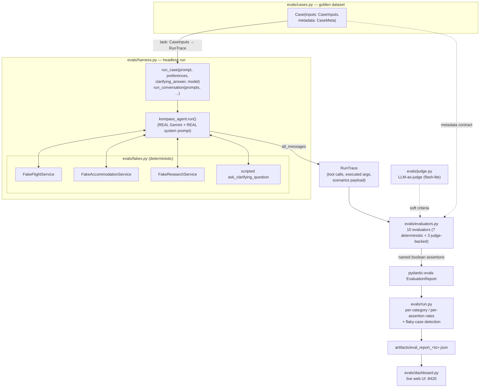

# Kompass Agent Evaluation Suite

How we measure whether the Kompass travel agent got **better or worse** after any
change to the prompt, model, or tools — automatically, repeatably, and with a
number you can gate a PR on.

The existing `pytest` suite (`backend/tests/`) tests *code*. This suite tests
*model behavior*: given a real user request, does the agent call the right
tools, honor the traveler's constraints, avoid fabricating data, and produce a
structurally sound plan? That question can't be answered by a unit test — it
needs the real LLM in the loop.

> This file is the technical reference (architecture, fixtures, evaluators,
> how to run it). For the running, chronological record of what each eval run
> actually *found* — regressions caught, root causes, before/after numbers —
> see [`evals.html`](evals.html), updated every time we learn something new.

---

## 1. The core principle

> **The LLM is the system under test. Everything else is deterministic.**

Evals run the **real** Gemini model against the **real** production system
prompt and the **real** agent tool graph. Only the outermost data layer —
flights, accommodations, grounded web research — is swapped for deterministic
fakes with hand-designed fixtures.

Why this split matters:

- If we mocked the model, we'd be testing our mocks, not the agent.
- If we hit **live** flight/hotel APIs, a score drop could mean "the prompt
  regressed" *or* "Kiwi changed its prices today." Faking the data layer
  removes that ambiguity: **a score change can only come from the model or the
  prompt.**
- The fixtures are *adversarial* — each is built so that a specific failure
  (ignoring a constraint, fabricating a price) becomes **observable** in the
  agent's tool calls or output.

---

## 2. Architecture & flow



**File map** (`backend/evals/`):

| File | Responsibility |
| --- | --- |
| `schema.py` | Typed models: `CaseInputs` (incl. `followups` for multi-turn, `case_name`/`case_category` for Langfuse tagging), `CaseMeta` (the expected-behavior contract), `RunTrace` (serializable run projection). |
| `fixtures.py` | Adversarial catalogs: flight routes, per-city hotels, keyword-matched research answers. |
| `fakes.py` | `FlightServicePort` / `AccommodationServicePort` / `ResearchServicePort` implementations over the fixtures; each records its calls. |
| `harness.py` | `run_case(...)` / `run_conversation(...)` → runs the real agent headless (single-turn or multi-turn) with fakes injected; extracts an `EvalRunResult`. |
| `judge.py` | The LLM-as-judge: a small structured-output agent (`Verdict{passed, reason}`) scoring soft criteria, decoupled from the agent-under-test's model. |
| `evaluators.py` | Ten evaluators (7 deterministic + 3 judge-backed) that turn a `RunTrace` + `CaseMeta` into named pass/fail assertions. |
| `cases.py` | The 30-case golden `Dataset` (Cases defined in Python). |
| `tasks.py` | The pydantic-evals task: `CaseInputs → RunTrace`, dispatching to `run_case` or `run_conversation` (with optional model override); wraps each call in `app.telemetry.trace_attributes(environment="eval", ...)` (see §10). |
| `run.py` | CLI runner: executes the dataset, prints/aggregates (incl. per-case flakiness across `--repeat`), writes the JSON report; calls `init_telemetry()`/`flush_telemetry()` around the run. |
| `dashboard.py` | Stdlib web UI that reads the report folder live. |

---

## 3. The headless harness

`harness.run_case()` is the seam that makes the agent evaluable outside the
FastAPI/AG-UI stack:

- **Real prompt.** Uses the production `FilePromptService` over
  `app/agent/prompts/` — the exact system prompt that ships.
- **Fakes injected via ports.** `AgentDependencies` carries
  `flight_service` / `accommodation_service` / `research_service`. Phase 1
  extracted `ResearchServicePort` specifically so grounded web research (which
  used to be a hard module import) could be swapped like the others.
- **Production-mirroring limits.** `UsageLimits(request_limit=30)` and
  `model_settings={"timeout": 60.0}` match `app/api/routes.py`, so eval behavior
  matches prod behavior.
- **Human-in-the-loop stub.** `ask_clarifying_question` is a *frontend* tool
  (CopilotKit `useHumanInTheLoop`) — it doesn't exist headless, and a call to a
  missing tool would exhaust the run's output retries. The harness registers a
  scripted stand-in (`FunctionToolset`) that answers with a per-case scripted
  reply, else the first offered option. This keeps the tool surface identical to
  production and lets us later test *whether the agent asks when it should*.
- **Structured extraction.** From `result.all_messages()` it pulls the ordered
  tool calls (name + args), tool return values, the final successful
  `generate_scenarios` payload, the final text, and token usage.
- **Multi-turn refinement.** `run_conversation(prompts, ...)` runs a list of
  turns against **one** shared `AgentDependencies`/fakes instance, threading
  `message_history` between calls exactly like a real refinement session
  ("...now add a cheaper option," "make it for 4 people instead"). The
  returned `EvalRunResult` reflects the final turn; recorded fake calls
  accumulate across the whole conversation so evaluators see the full history.

`RunTrace` (in `schema.py`) is a compact, JSON-serializable projection of that
result — exactly what the evaluators need — so pydantic-evals can serialize
outputs into its report/OTel spans without choking on live agent objects.

---

## 4. Adversarial fixtures

The fixtures are the test instrument. Each is engineered so a constraint
violation shows up in the trace.

| Fixture | Design | What it catches |
| --- | --- | --- |
| **BER→LIS flights** | Direct flights exist but cost ~2× the 1-stop options. | `direct_flights_only` → `max_stops=0` honored even when it's pricier. |
| **BER→ATH flights** | Cheapest options are red-eyes (dep. 22:00–02:00); daytime costs more. | "No red-eyes" adherence — the model must pay up for daytime legs. |
| **MUC→JMK flights** | Always returns `[]`. | Anti-fabrication: must fall back to `search_web` and flag `estimated`, not invent a price. |
| **Per-city hotels** | Milos/Paros/Naxos/Athens/Santorini/Lisbon catalogs honoring `max_price`/`min_rating`/`guests`. | Party-size propagation, budget filtering, per-island lodging. |
| **Keyword research** | Canned grounded answers for ferry/train/flight/hotel/seasonality queries, all hedged "approximate". | Ground-transport legs, price fallbacks, seasonality reasoning. |
| **Unknown routes** | Deterministic synthetic options seeded by route name. | The harness never breaks because the model picked an unexpected airport. |

Flight prices scale with `passengers`, so "family of 4" budget constraints are
genuinely tight. Every fake records its calls (`.calls`) so evaluators can
assert on the **executed, post-validation** arguments (e.g. `max_stops == 0`),
which is stronger than parsing the model's raw tool-call JSON.

---

## 5. The golden dataset & the `CaseMeta` contract

30 cases across seven diagnostic categories (`cases.py`), grown from the
Phase 2 baseline of 12/six. Most prompts are self-contained ("decide sensibly,
no clarifications") so a single headless turn completes; the HITL cases
deliberately withhold required info, and the multi-turn cases attach
`followups` so `tasks.py` routes them through `run_conversation`.

Each case carries a `CaseMeta` — an **all-optional** expected-behavior contract.
An evaluator emits an assertion **only** when the relevant field is set, so a
case is scored *solely on the behaviors it targets* (a budget case isn't
penalized for not being an island hop).

| Category | Cases | Targets |
| --- | --- | --- |
| `tool_selection` | 5 | flexible dates → `find_cheapest_dates`; round trip → ≥2 one-way `search_flights`; seasonality → `search_web`; lodging-only scope skips flight tools; rail preference skips flight tools. |
| `constraint_adherence` | 7 | budget cap (+ a deliberately **infeasible** cap that must not be fabricated into a fake fit); direct-only `max_stops=0` (incl. on a synthetic/off-catalog route); daytime-only flights; family-of-4 budget; currency propagation (e.g. `USD`). |
| `anti_fabrication` | 2 | empty flight route + a ferry-only route → `search_web`/`search_ground_transport` + `estimated: true`. |
| `manual_override` | 1 | "already have flights" → no flight tools, transportation = 0. |
| `party_propagation` | 4 | solo, family-of-4, and a group-of-6 → `passengers`/`guests` match exactly; a multi-turn "actually make it 4 people" refinement. |
| `itinerary_quality` | 8 | Greek island hops (single + two-window), fly+ferry, multi-city rail, a 2-option comparison judged for a **concise recommendation**, two **vibe-matched** itineraries ("relaxed foodie", "adventure hiking"), and a multi-turn "add a cheaper option" refinement. |
| `human_in_the_loop` | 3 | missing origin/dates → the agent must ask (`expect_clarification`); a fully-specified prompt → it must **not** ask (`forbid_clarification`). |

The `itinerary_quality` cases are modeled on a hand-built "golden" example (a
Milos→Paros→Naxos→Athens hop with per-island ferries and hotels). Crucially we
encode its *shape*, not its numbers (see §7).

---

## 6. Evaluators & assertions

Ten evaluators (`evaluators.py`), all attached at the dataset level and run on
every case. Each returns a `Mapping[str, bool]`; pydantic-evals records each
entry as a pass/fail **assertion** and aggregates pass rates across cases.

| Evaluator | Assertions emitted | When |
| --- | --- | --- |
| `ToolSelection` | `required_tools_called`, `forbidden_tools_avoided`, `round_trip_searched` | required/forbidden tools, `min_flight_searches` set |
| `ConstraintAdherence` | `budget_respected` / `no_overbudget_plan`, `direct_flights_only`, `daytime_flights_only`, `party_size_propagated`, `currency_respected`, `travelers_propagated` | budget cap (incl. infeasible) / direct-only / no-red-eye / party size / currency / traveler count set |
| `AntiFabrication` | `fell_back_to_search`, `prices_flagged_estimated` | `expect_estimated` set |
| `ManualOverride` | `transportation_zeroed` | `transportation_zero` set |
| `InternalConsistency` | `itemized_costs_sum_to_subtotals` | any scenario present |
| `PlanQuality` | `produced_a_plan`, `scenario_count_met`, `day_plan_covers_trip` | always / `min_scenarios` set |
| `ItineraryStructure` | `ground_legs_present`, `each_island_has_lodging` | `min_ground_legs` / `expect_islands` set |
| `HITLBehavior` | `asked_when_underspecified`, `did_not_ask_when_complete` | `expect_clarification` / `forbid_clarification` set |
| `ConciseRecommendation` *(judge)* | `concise_recommendation` | `judge_recommendation` set |
| `VibeMatch` *(judge)* | `vibe_matches_activities` | `judge_vibe` set |

**Assertions test structure and constraints, never exact prices, dates, or
hotel names.** That's deliberate — the fixtures already remove data drift;
asserting specific values would overfit the suite to one plan and make it
brittle to harmless rewordings.

### The LLM-as-judge (`judge.py`)

Two criteria can't be expressed as a Python `assert`: *does the chat reply
read as a concise recommendation rather than a wall of prose?* and *do the
day-by-day activities actually match the requested vibe* ("relaxed foodie",
"adventure hiking")? `judge.py` is a tiny structured-output agent
(`Verdict{passed: bool, reason: str}`) that sees **only** the focused slice
each evaluator hands it — the final reply text, or a compact day-by-day
digest with prices/dates stripped — never the whole trace, so prompts stay
cheap and hard to game.

The judge model is **deliberately decoupled** from the agent under test: it
defaults to `gemini-2.5-flash-lite` (a boolean rubric is well within its
ability, and it's cheap), while the agent under test stays on whatever ships
in `LLM_MODEL`. This means a judge-cost optimization can never quietly change
what the suite is actually measuring. Both are configurable independently,
in priority order **CLI flag → env var (`backend/.env` or shell) → default**:

| Slot | CLI flag | Env var | Default |
| --- | --- | --- | --- |
| Agent under test | `--model` | `EVAL_MODEL` | `LLM_MODEL` (prod — "test what ships") |
| LLM judge | `--judge-model` | `EVAL_JUDGE_MODEL` | `google:gemini-2.5-flash-lite` |

Every JSON report records both `model` and `judge_model` for reproducibility.

---

## 7. A senior design decision worth calling out: don't eval the model on arithmetic

`InternalConsistency` checks that the model's own line items (`Leg.cost`,
`Accommodation.cost`) sum to the subtotals it reports. During the Phase 2
baseline this scored **75%** — and diagnosing it produced the suite's first real
win:

On multi-leg trips the model's line items were **correct and complete** (six
legs for a round-trip island hop, four hotels — all tool-sourced), but it
reported nonsense subtotals: transportation **€600** when its own legs summed to
**€1252**. Root cause: **Flash can't reliably add six numbers.**

The fix was *not* to beg the model to do better math in the prompt. Deterministic
arithmetic should never be delegated to an LLM. `generate_scenarios`
(`app/agent/agent.py`) now **re-derives** the subtotals from the itemized line
items — `transportation = sum(Leg.cost)`, `accommodation = sum(Accommodation.cost)`
— then the grand total from the subtotals, the same source-of-truth pattern
already used for `grand_total`. Result: **75% → 100%**, and the traveler-facing
totals are now guaranteed correct.

That flips `itemized_costs_sum_to_subtotals` from a *model signal* into a
*pipeline invariant guard*: it now catches anyone removing the normalization,
which is exactly what a regression test should do. This is the whole loop in one
example — **eval caught it → root-caused it → fixed it at the right layer → eval
confirmed it.**

---

## 8. Running it

```bash
cd backend

# Full dataset against the model in .env (LLM_MODEL, currently gemini-2.5-flash)
uv run python -m evals.run

# Cheaper/other model, a single case, or a variance study
uv run python -m evals.run --model google:gemini-2.5-flash
uv run python -m evals.run --judge-model google:gemini-2.5-flash-lite
uv run python -m evals.run --case greek_island_hop_single_plan
uv run python -m evals.run --repeat 3
uv run python -m evals.run --concurrency 4
```

> **Concurrency vs. quota.** High `--concurrency` × `--repeat` can trip Gemini
> rate limits (`429 RESOURCE_EXHAUSTED`) or request timeouts
> (`504 DEADLINE_EXCEEDED`) — these show up as "errored" cases but are **not**
> a model/prompt regression. `run.py`'s per-case aggregation reports
> `error_runs` separately from failed assertions specifically so this
> infra noise doesn't get misread as a real signal; re-run flagged cases at a
> lower `--concurrency` before trusting a red result (see the log entry in
> [`evals.html`](evals.html)).

The runner prints the pydantic-evals table plus per-category and
per-assertion pass rates, a **cases needing attention** list (failed
assertions and/or errored runs), and — when `--repeat > 1` — a **flaky
across repeats** section that collapses re-runs of the same case and flags
any assertion that didn't pass consistently. It then writes
`artifacts/eval_report_<ts>.json` (including `model` and `judge_model`).

> **Cost/keys.** Real runs call Gemini and spend tokens (`GOOGLE_API_KEY`
> required). The data layer is faked, so no paid flight/hotel API calls are
> made. `artifacts/` is git-ignored, so reports stay local.

### Dashboard

```bash
uv run python -m evals.dashboard        # → http://localhost:8420
```

A stdlib-only web server (no frontend toolchain, no deps) that reads
`artifacts/eval_report_*.json` **live** and auto-refreshes every 3s: overall
pass-rate trend across runs, per-category and per-assertion bars, a per-case
assertion table (errored cases flagged), and a run picker. It re-reads the
folder on every poll, so new runs appear on their own.

---

## 9. Baseline (Phase 2 → Phase 3, `gemini-2.5-flash`)

**Phase 2 (12 cases, 6 categories):** post cost-itemization fix, **100%**
across all six categories (pre-fix baseline was 93.8%, with the
cost-itemization gap described in §7). Everything else — budget caps,
direct-only `max_stops=0`, daytime/no-red-eye legs, party-size propagation,
empty-route fallback + `estimated` flag, per-island lodging, ≥3 ferry legs, full
day-by-day coverage — passed on the first live baseline.

**Phase 3 (30 cases, 7 categories):** at a safe concurrency, **22/30 cases ran
clean with 100% of executed assertions passing** — including all the new
categories (currency propagation, infeasible-budget honesty, solo/group-of-6
party sizes, HITL ask/don't-ask, multi-turn refinement, and the LLM-judge
criteria). A first pass at `--repeat 3 --concurrency 6` looked catastrophic
(~28/30 "failing") but turned out to be **Gemini rate-limiting from
over-concurrency**, not a regression — re-running the flagged cases
individually at low concurrency isolated **2 genuinely reproducible**
failures, both the heaviest single-plan syntheses
(`greek_island_hop_single_plan`, `vibe_relaxed_foodie`): they consistently hit
`UnexpectedModelBehavior: Exceeded maximum output retries` — Flash
intermittently returns an empty completion on a very large final-synthesis
context.

Attempted fix: raised the agent's output-retry budget
(`retries={'tools': 2, 'output': 2}` in `app/agent/agent.py`, up from the
pydantic-ai default of 1). Re-verified on the same two cases: **still fails**
(now `Exceeded maximum output retries (2)`) — one extra retry isn't enough to
recover from an empty completion on this much output. This is logged as an
**open** finding, not a closed one; the next candidates are lightening the
single-plan day-by-day detail the prompt asks for, or splitting the synthesis
into two tool calls. Full chronological write-up (with before/after evidence
for every finding above): [`evals.html`](evals.html).

---

## 10. Langfuse observability: telling eval traces from live traffic

Every agent run — production or eval — already flows through the same
[`app/telemetry.py`](../backend/app/telemetry.py) Langfuse/OpenTelemetry
instrumentation (`Agent.instrument_all()`, wired once at process startup). The
eval suite reuses that exact pipeline rather than a separate one, so a trace
looks identical whether it came from a real trip or a `--case` debug run —
except for the attributes that mark which is which:

| Attribute | Production (`app/api/routes.py`) | Eval (`evals/tasks.py`) |
| --- | --- | --- |
| `environment` | `"production"` | `"eval"` |
| `session_id` | the trip's thread id (groups a conversation's turns) | the eval run's timestamp (groups every case + repeat in one `evals.run` invocation) |
| `trace_name` | (unset — defaults to the agent/operation name) | the case name (e.g. `group_of_six_propagation`) |
| `tags` | `["kompass-agent"]` | `["kompass-eval", <category>]` |
| `metadata` | — | `eval_case`, `eval_category`, `eval_repeat` (which repeat, for `--repeat` runs), `eval_model` |

Mechanically: `evals/schema.py`'s `CaseInputs` carries `case_name`/
`case_category`, auto-populated from each `Case` by `build_dataset()` (the
pydantic-evals task callable only receives `CaseInputs`, not the surrounding
`Case`, so this is how the name/category survive to trace time). `evals/tasks.py`
wraps each case's `run_case`/`run_conversation` call in
`telemetry.trace_attributes(...)` with the table above; `evals/run.py` calls
`init_telemetry()` once up front and `flush_telemetry()` in a `finally` block
(a short-lived CLI process would otherwise exit before the batched OTel
exporter flushes). All of this is a no-op — zero overhead, no branching needed
at call sites — when `LANGFUSE_*` keys aren't configured.

**Why this matters for debugging**: every case in this doc's Phase 3 findings
(§9) — the "friends"-triggered fabrication, the `already_have_flights` 504s,
the output-retry exhaustion — was root-caused by re-running the case headless
and eyeballing printed tool calls. With this wired in, the same investigation
is a Langfuse query instead: filter `environment = eval`, `traceName =
group_of_six_propagation`, and get the full input/output/token/cost trace for
every attempt, side by side with the LLM's exact reasoning and tool-call
arguments — no custom debug scripts needed. Filtering `environment =
production` excludes all of this eval noise from real-traffic dashboards, and
vice versa.

This is distinct from the roadmap's optional item 3.5 (Langfuse **dataset**
runs — Langfuse's structured "run this dataset, get a scored table" feature):
what's described here is trace-level tagging for ad-hoc debugging, verified
working end-to-end (a live `evals.run --case` invocation was confirmed to land
in Langfuse with the correct `environment`/`session_id`/`tags`/`metadata` via
the Langfuse API). Publishing to Langfuse's Datasets product for
version-over-version score history is still open.

---

## 11. Design decisions

| Decision | Choice | Rationale |
| --- | --- | --- |
| Real model vs replayed | Real Gemini, faked data layer | The LLM is the thing under test; fixtures remove data drift so score changes are attributable. |
| Agent-under-test model | Same as prod — `LLM_MODEL` from `.env`, overridable via `--model`/`EVAL_MODEL` | Test what ships. |
| Judge model | Decoupled from the agent under test — `gemini-2.5-flash-lite` by default, overridable via `--judge-model`/`EVAL_JUDGE_MODEL` | A boolean rubric doesn't need the prod tier; decoupling means a judge-cost change can't silently change what's measured. |
| Where evals live | `backend/evals/`, separate from `tests/` | Different cadence, cost, and trigger than unit tests. |
| Cases: YAML vs Python | Python with typed `CaseMeta` | Rich, conditional, typed metadata reads clearer and skips evaluator-registry indirection. |
| Scoring philosophy | Assert structure/constraints, never exact values | Avoids overfitting to one plan; robust to rewordings. |
| Arithmetic | Derived server-side from line items, not scored on the model | Deterministic math must not be an LLM responsibility (see §7). |
| HITL | Scripted stub toolset in the harness | The frontend tool is absent headless; a call to a missing tool exhausts output retries. |
| Soft criteria | LLM-as-judge sees only a focused slice (final reply / day digest), never the full trace | Keeps judge prompts cheap and hard to game. |
| Gate granularity | Per-category pass rates, not per-case | LLM nondeterminism; thresholds set from variance data (Phase 3). |
| Call inspection | Assert on fakes' recorded (executed) args | Post-validation args are stronger evidence than raw model tool-call JSON. |
| Infra vs. signal | `run.py` separates `error_runs` (429/504) from failed assertions | A rate-limited run must never be misread as a prompt/model regression. |

---

## 12. Roadmap

- **Phase 1 — ✅ Headless evaluability.** `ResearchServicePort` extraction,
  deterministic fakes, the harness. All 60 backend tests green.
- **Phase 2 — ✅ Golden dataset + deterministic scorers + baseline.** 12 cases,
  7 evaluators, live baseline, first regression found & fixed, dashboard.
- **Phase 3 — 🟡 LLM-as-judge + growth (mostly done).** ✅ `judge.py` LLM-judge
  for soft criteria (concise recommendation, vibe match), decoupled model
  config; ✅ HITL eval category; ✅ multi-turn refinement cases
  (`run_conversation`); ✅ grown to 30 cases across 7 categories; ✅ a first
  variance pass that both taught an infra-vs-signal lesson and isolated a real,
  reproducible output-retry issue on heavy single-plan synthesis (still open —
  see §9); ✅ Langfuse trace tagging for eval vs. live traffic (§10). ⬜
  Remaining: a clean multi-repeat variance run (now that concurrency is tuned)
  to set defensible per-category CI thresholds; optional Langfuse
  dataset-run publishing (3.5, distinct from the trace tagging above).
- **Phase 4 — ⬜ CI gating.** A separate `evals.yml` workflow, path-filtered to
  `backend/app/agent/**` (incl. the system prompt), that fails a PR when a
  category pass rate drops below threshold — "eval-gated prompt deployment."

---

## 13. What this demonstrates

- **Agent evaluation as an engineering discipline**, not vibes: golden dataset,
  deterministic harness, typed expectation contracts, categorized pass rates.
- **Attributable measurement** — faking the data layer so a metric move means a
  prompt/model change, nothing else.
- **Root-causing an LLM failure to the right layer** — recognizing an arithmetic
  bug shouldn't be solved with prompt-pleading, and moving it out of the model's
  responsibility entirely.
- **Distinguishing infra noise from real signal** — a wall of "failures" from
  API rate-limiting isn't a regression, and a runner that can't tell the
  difference will teach a team to ignore red builds.
- **Honest reporting of open issues** — the heavy-synthesis output-retry
  failure is tracked as *open* after one fix attempt didn't fully resolve it,
  not quietly dropped once the number looked good enough.
- **A closed feedback loop** ready to gate CI: measure → diagnose → fix →
  re-verify → prevent regression.
